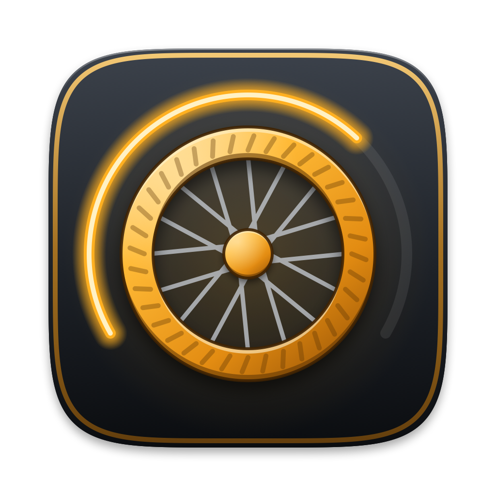
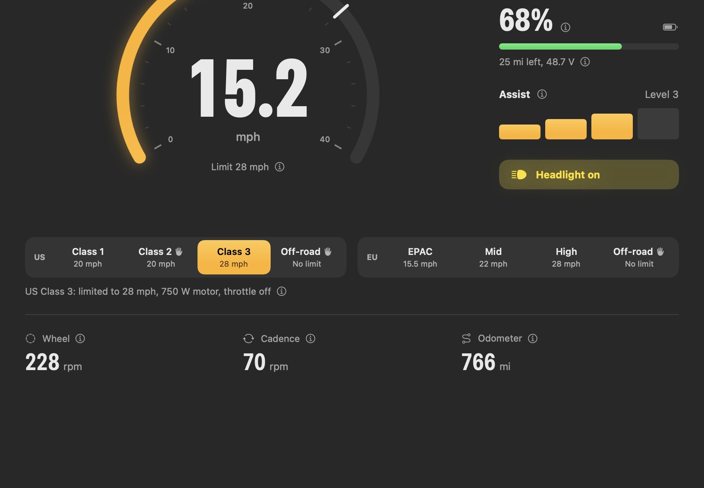
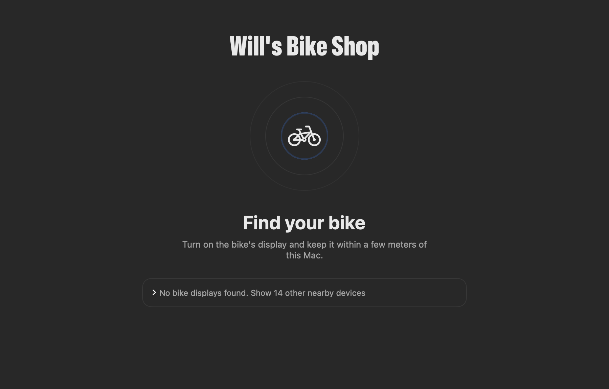
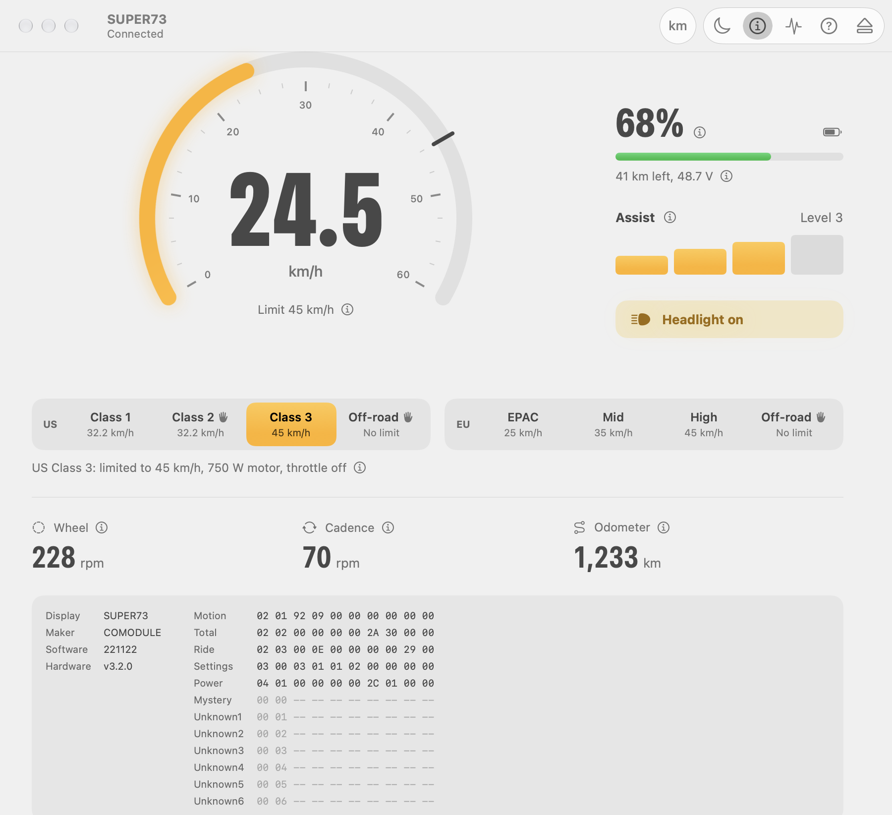
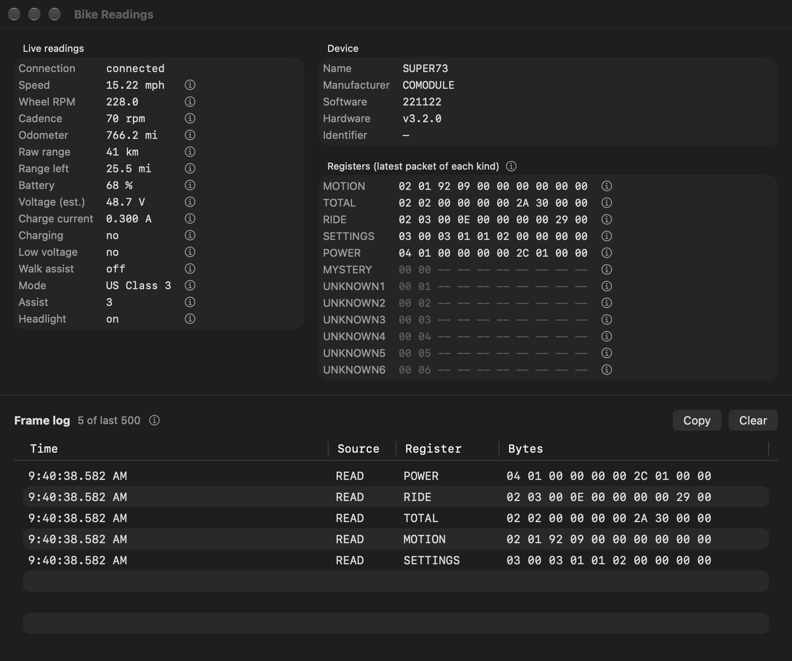
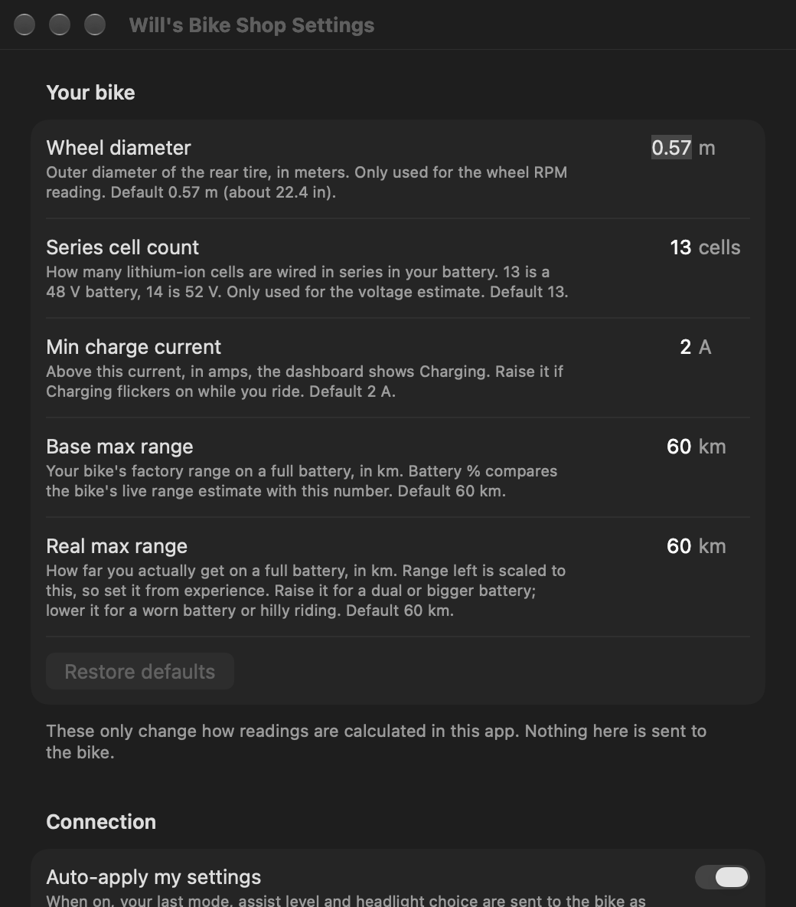

<p align="center">
  
</p>

<h1 align="center">Will's Bike Shop</h1>

<p align="center">
  <b>A native Mac dashboard for e-bikes with a Comodule display.</b><br>
  Live speed, battery and range, ride modes, assist and lights, over Bluetooth.<br>
  No account, no internet, no tracking.
</p>

<p align="center">
  <a href="https://github.com/jovonbuilds/wills-bike-shop/releases/latest"><b>⬇ Download for macOS</b></a>
  &nbsp;·&nbsp; macOS 15 or later &nbsp;·&nbsp; Apple silicon and Intel
</p>

<p align="center">
  
</p>

---

## What it does

- **Connects to your bike over Bluetooth.** It finds the bike's display and connects automatically next time.
- **Shows a live dashboard:** speed on a speedometer that marks your mode's legal limit, battery, range left, cadence, wheel RPM and odometer.
- **Changes ride settings:** all 8 riding modes (US Class 1–3, EU EPAC/Mid/High, Off-road), assist level 0–4 and the headlight.
- **Re-applies your settings when you connect.** This works around EU bikes that reset to the legal mode at every start.
- **Explains everything.** Every reading and setting has a plain-English explanation, and there's a full guide under Help.
- **Shows the raw data** in a Bike Readings window: every value the bike reports, the raw packets, and a copyable log for troubleshooting.
- **Respects your privacy.** It has no network access at all; the app is sandboxed with Bluetooth as its only permission.

## Download and install

1. Download **`WillsBikeShop-<version>.dmg`** from the [latest release](https://github.com/jovonbuilds/wills-bike-shop/releases/latest).
2. Open it and drag **Will's Bike Shop** onto **Applications**.
3. Open **Will's Bike Shop** from Applications. When it first looks for your bike, macOS asks for **Bluetooth** access; click **Allow**.

The app is signed with a Developer ID and notarized by Apple, so it opens like any other Mac app. You can also check your download against `SHA256SUMS.txt` from the release: `shasum -a 256 WillsBikeShop-*.dmg`.

## Compatible bikes

Bikes with a **Comodule** display, including models from:

Super73 · MATE · Swapfiets · Cake · Ego Movement · Äike · Donkey Republic · Fazua · PonBike · Taito · Hagen · Movelo

It has been used with a Super73. Other brands use the same display, but not every model has been tested. If yours works (or doesn't), please [open an issue](https://github.com/jovonbuilds/wills-bike-shop/issues).

## Using it

### 1. Find your bike

Turn on the bike's display and keep it within a few meters of your Mac. Comodule displays appear at the top of the list; click one to connect. Turn on **Auto-connect** in Settings and the app goes straight to the dashboard from then on.

<p align="center"></p>

### 2. Ride dashboard

| What you see | What it means |
|---|---|
| **Speedometer** | Your speed. The white mark is the top speed the motor assists to in the current mode. |
| **Battery %** | Estimated from the bike's range estimate. Click it to switch to estimated voltage. |
| **Range left** | The bike's estimate, rescaled to your real-world range (set it in Settings). |
| **Assist** | 0 is off, 4 is the most help. Click a bar to choose a level. |
| **Headlight** | Click to turn it on or off. |
| **Modes** | US and EU groups, color-coded: amber for US, blue for EU, red-orange for off-road. |
| **Wheel / Cadence / Odometer** | Wheel RPM, pedaling speed, and total distance. |

Click any **ⓘ** for a full explanation, or open **Help → Will's Bike Shop Guide** (⌘?).

<p align="center"></p>

### 3. Bike Readings (for troubleshooting)

**⇧⌘R** opens a window with every live value, the raw packets for each data type (each with a byte-by-byte explanation), and a log of everything received. Click **Copy** to share the log when asking for help.

<p align="center"></p>

### 4. Settings

**⌘,** opens Settings. Every option has its explanation printed right under it.

<p align="center"></p>

### Keyboard shortcuts

| Key | Action |
|---|---|
| `M` | Next riding mode |
| `E` | Switch to EU EPAC (road legal in Europe) |
| `A` | Next assist level |
| `L` | Headlight on/off |
| `⌘U` | Kilometers / miles |
| `⇧⌘R` | Bike Readings window |
| `⇧⌘D` | Disconnect |
| `⌘?` | Guide |

## Troubleshooting

**No bikes in the list.** Make sure the bike's display is on, and that nothing else (like a phone app) is connected to it; a display only takes one connection at a time. Click **Scan again**.

**"Bluetooth permission denied."** Open **System Settings → Privacy & Security → Bluetooth** and turn on Will's Bike Shop.

**Connected, but speed, battery and range all show 0.** The app is talking to the display, but the display isn't getting data from the bike's motor controller. Check that the battery is on and charged, and that the cable between the display and the controller is fully plugged in. Bike Readings will show all-zero packets in this case.

**Readings look frozen while riding.** Turn on **Settings → Keep asking the bike for readings**.

## Safety and the law

Riding modes change your bike's speed and power limits. **Which modes are legal depends on where you ride.** Off-road modes are for private land. Check your local rules, and change settings while stopped.

This is an independent project. It isn't affiliated with or endorsed by Comodule, Super73 or any bike maker. Use it at your own risk.

## Build from source

You need **Xcode 16 or later** on **macOS 15 or later**.

```sh
git clone https://github.com/jovonbuilds/wills-bike-shop.git
cd wills-bike-shop
open WillsBikeShop.xcodeproj        # then press ⌘R
```

Run the tests, or build the downloadable `.dmg` and `.zip` yourself:

```sh
swift test --package-path BikeKit   # protocol tests
./scripts/build-release.sh          # universal build into dist/
```

`build-release.sh` signs and notarizes automatically when your keychain has a Developer ID Application certificate and a `notarytool` profile named `wills-bike-shop`; otherwise it makes a locally signed build. Details are at the top of the script.

To try the interface without a bike, run with the `-demo YES` launch argument (Xcode: Product → Scheme → Edit Scheme → Arguments).

### Project layout

| Path | What's there |
|---|---|
| `BikeKit/` | Swift package: the Bluetooth protocol, packet decoding, and the CoreBluetooth connection. Unit-tested. |
| `WillsBikeShop/` | The SwiftUI app: dashboard, bike finder, Bike Readings, Settings and Guide. All the explanation text lives in `Explanations.swift`. |
| `scripts/` | `build-release.sh` packages a release; `render-icon.swift` draws the app icon. |

### How it talks to the bike

The display exposes a "register" over Bluetooth LE. The app writes a 2-byte ID to choose which data it wants (speed, ride data, power, odometer or settings), then reads a 10-byte packet back; the display also pushes packets when values change. Settings are written as a single 10-byte packet. `BikeKit/Sources/BikeKit/BikeProtocol.swift` documents the layout, and the Bike Readings window explains each byte.

## Credits and license

MIT License; see [LICENSE](LICENSE), which also carries the notices for the open-source work this builds on. The icon renderer is adapted from [Reload](https://github.com/miotke/reload) by miotke (MIT).
